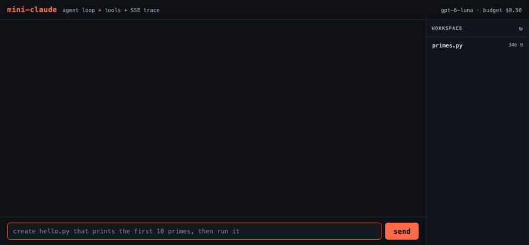

# mini-claude

A small coding agent: the parts of Claude Code that matter, with the parts that
don't deliberately left out. Terminal REPL and a web UI that streams the agent's
thinking, tool calls and results live.

The agent itself is ~630 lines (`agent.py`, `context.py`, `tools.py`, `main.py`,
`server.py`). The other ~340 are what it took to put it on the internet without
getting robbed — `limits.py`, `usage.py`, `entrypoint.py`. That ratio is the
honest part of the project.

**Try it → [mini-claude-production-002f.up.railway.app](https://mini-claude-production-002f.up.railway.app)**
*(10 messages per visitor, cheap model, locked-down shell — it sleeps when idle,
so the first load takes a few seconds)*


Nothing in the harness handles that retry. `run_bash("python fizzbuzz.py")`
returned exit 127, and that was simply true information in the next request —
so the model tried `python3`. The loop is what makes self-correction free.

## Run it

```bash
python -m venv .venv && .venv/bin/pip install -r requirements.txt
cp .env.example .env            # then put your OPENAI_API_KEY in it

.venv/bin/python models.py                       # which models can my key see?
.venv/bin/python main.py                         # terminal
.venv/bin/python main.py "write fizzbuzz"        # one-shot
.venv/bin/python -m uvicorn server:app --reload  # web UI on :8000
.venv/bin/python usage.py                        # what have I spent
```

## Cost

Default model is `gpt-6-luna` ($0.10/$0.50 per MTok), the cheapest GPT-6. A
real task — write a script, run it, fix it, report — is **4-5 API calls and
about $0.0006**. Set `OPENAI_MODEL` to spend more on harder work:
`gpt-6.1-terra` ($1/$5), `gpt-6.1-sol` ($2/$10), `gpt-6-astra` ($10/$50, best
at code).

Every call is priced and appended to `.miniclaude/usage.jsonl`. `usage.py`
totals it per model. A session stops making calls once it crosses
`MINI_CLAUDE_BUDGET_USD` (default `$0.50`) — checked *before* each call, since a
runaway tool loop is the expensive failure mode. `reasoning.effort` is `"low"`
in `agent.py`; raise it if the agent gets sloppy.

## How it works

```
main.py / server.py     two renderers over one event stream
        |
    agent.py            the loop: stream -> run tools -> append -> repeat
       /  \
context.py  tools.py    what the model knows     what the model can do
        |         \
 .miniclaude/      limits.py + usage.py    what it may do, and what it costs
 CONTEXT.md,                               (allowlist, caps, spend ledger)
 skills/, sessions/
```

**The loop is the product.** `agent.py` sends the conversation, and if the reply
contains `function_call` items it runs them locally, appends the results, and
sends again. It stops when the model answers in plain text.

**The model is stateless.** Nothing persists server-side. Every turn re-sends the
whole conversation, so all "memory" is this harness rebuilding a text blob from
disk. `context.py` is that rebuild.

**The model has no hands.** It can't read a file; it emits
`{"type":"function_call","name":"read_file","arguments":"{...}"}` and `tools.py`
decides what actually happens. Model-supplied paths are untrusted *output*, not
validated input — `safe_path` refuses anything outside the session's workspace,
and `run_bash` is time-, memory- and command-limited.

**Skills load lazily.** Only each skill's `name` + `description` go into the
system prompt. The body arrives when the model calls `load_skill`. 50 skills cost
50 lines of context instead of 50 documents.



Watch the order: `load_skill("code-review")` fires *before* it reads the file.
The expanded row is the whole of `.miniclaude/skills/code-review/SKILL.md`,
which was not in the model's context a second earlier — the system prompt only
carried its one-line description.

Then it does what the skill told it to, in order: read the target, run it, and
report findings with line numbers. It caught the planted bug —
`is_prime` has no `n < 2` guard, so the loop body never runs for `n = 1`,
`is_prime(1)` returns `True`, and `1` is printed as the first prime. That's the
test of a skill: not that it loaded, but that the work changed shape because of
what it said.

**History is append-only, and we own it.** This uses the **Responses API** (the
GPT-6 flagship models require it for tool calling) with `store=False`, so OpenAI
keeps nothing — `self.items` is the only copy of the conversation. The obvious
alternative, `previous_response_id`, would let OpenAI hold the thread and hide
the exact thing this project exists to show.

Two consequences. OpenAI caches long prefixes automatically — there's no
`cache_control` to set — so never rewriting an earlier turn is what makes the
cache hit; the `cached` number in the usage line is the proof. And reasoning
models need their own `reasoning` items handed back verbatim alongside the tool
outputs, which falls out of appending all of `response.output` unmodified.

> Measured: the first call of a session is 0% cached and the prefix is ~800
> tokens, below OpenAI's 1024-token caching floor. Once the conversation grows
> past it the cache kicks in hard — **35% by turn two, 63-71% by turn three.**
> So the floor is real but you clear it almost immediately, and the payoff is
> large. Worth knowing that a *bigger* system prompt is what gets you over the
> floor sooner, which is the opposite of the usual "keep prompts small"
> instinct.

**You can watch the workspace.** The right-hand pane lists everything under
`workspace/` and refreshes itself whenever a tool writes; click a file to read
it. `/api/file` reuses the exact same `safe_path` guard the tools do, so the
viewer can't read outside the workspace either.

**One event stream, two UIs.** `Agent.run()` yields plain dicts
(`text`, `thinking`, `tool_start`, `tool_input`, `tool_result`, `done`). The
terminal prints them with ANSI colours; `server.py` reserialises the same dicts
as SSE frames. Neither renderer imports the OpenAI SDK — which is why swapping
providers touched only `agent.py` and `tools.py`.

## Deliberately not built

Permission prompts, context compaction, subagents, hooks, MCP, multi-file edits.
Each is a known layer of the real thing, left out to keep the loop readable.

## Deploying

It's a Python process holding open SSE connections, so it needs a host that
runs a container — not Vercel/Netlify static. The `Dockerfile` works anywhere:

```bash
docker build -t mini-claude .
docker run -p 8000:8000 -e OPENAI_API_KEY=sk-... mini-claude
```

**Cloud Run** scales to zero, so an idle demo costs nothing:

```bash
gcloud run deploy mini-claude --source . --allow-unauthenticated \
  --set-env-vars DEMO_MODE=1 --set-secrets OPENAI_API_KEY=openai-key:latest
```

**Railway** is fewer steps if you already use it — step-by-step in
[docs/DEPLOY.md](docs/DEPLOY.md), including the bit that bites: its filesystem
is ephemeral, so without a mounted volume the daily spend cap resets on every
wake. Back it with a monthly budget on the OpenAI account, which is the only
limit that's enforced regardless of what the container does.

`OPENAI_API_KEY` is **never baked into the image** — `.env` is in
`.dockerignore` and deleted in the build. The host injects it at runtime.

## Not getting abused

A public agent with `bash` is a server you've handed to strangers. `DEMO_MODE=1`
(the Dockerfile default) turns on five controls, in `limits.py`:

| Risk | Control |
|---|---|
| Reading your API key out of the shell | `clean_env()` — the subprocess gets `PATH`/`HOME`/`LANG`/`TMPDIR` and nothing else. **On always, demo or not.** |
| Using your box to attack something | Command **allowlist** (`python3`, `ls`, `cat`, `grep`, …). No `curl`, `pip`, `nc`, `ssh`; no `$`, backticks, `>` or `<`. |
| Burning your credits | `DAILY_USD_CAP` across *all* visitors (default $1), checked before every call |
| One visitor hogging it | `SESSION_MSG_CAP` (10) + `RATE_PER_MIN` per IP (6) |
| Seeing another visitor's files | One `workspaces/<session_id>/` per visitor |

Plus: non-root user who doesn't own the source, 64 KB write cap, 40-file
workspace cap, 30s wall timeout and a `ulimit` of 25 CPU-seconds / 512 MB per
command, 20-turn loop cap, session ids validated against
`^[A-Za-z0-9_-]{1,64}$` before they reach the filesystem.

Why an allowlist and not a blocklist: a blocklist of dangerous commands is a
list you are permanently one entry short on. The leftover `BLOCKED` tuple in
`tools.py` is a seatbelt for *local* use, not the control.

What this still isn't: a sandbox. `run_bash` is a real shell in the container
and `python3` can open sockets. For anything beyond a demo you'd want gVisor,
a Firecracker microVM, or egress network policy. Said plainly because an
interviewer will ask.

## Re-recording the demo

```bash
.venv/bin/pip install playwright && .venv/bin/playwright install chromium
.venv/bin/python -m uvicorn server:app --port 8000     # one terminal

# docs/demo.gif — the hero clip
.venv/bin/python scripts/record_demo.py --open-file

# docs/skills.gif — needs a primes.py in workspace/ to review first
.venv/bin/python scripts/record_demo.py \
    --out docs/skills.gif --prompt "review primes.py" --expand load_skill
```

Drives the page headless, screenshots at 5fps while the agent streams, stitches
with ffmpeg (palettegen for colour). `--expand <tool>` clicks a tool row open at
the end so the clip shows what actually came back. Playwright and ffmpeg are
demo-only — they are not in `requirements.txt`.

## Swapping the model provider

`main.py`, `server.py` and `static/index.html` contain zero provider code — this
was ported from the Anthropic SDK to OpenAI by rewriting `agent.py` and the tool
schemas in `tools.py`, and nothing else. That's the payoff of the event-dict
boundary.

The schemas differ more than you'd expect: OpenAI's `strict: true` demands
`additionalProperties: false` *and* every property listed in `required`, so
there are no optional tool arguments here.

## Tools

| Tool | What it does |
|---|---|
| `list_files` | List a directory in the workspace |
| `read_file` | Read a text file, line-numbered |
| `write_file` | Create/overwrite a file |
| `run_bash` | Shell command in the workspace; 30s wall timeout, 25 CPU-seconds, 512 MB, allowlisted in demo mode |
| `load_skill` | Pull one skill's full instructions into context |

Watching it self-correct is the best part of the demo: `run_bash("python x.py")`
returns exit 127, so it tries `python3` and moves on. Nothing in the harness
handles that — the tool result is just true information, and the loop lets the
model act on it.

## Config

| Path | Purpose |
|---|---|
| `.miniclaude/CONTEXT.md` | Project rules, pasted into the system prompt verbatim (the `CLAUDE.md` equivalent) |
| `.miniclaude/skills/<name>/SKILL.md` | A skill: YAML frontmatter (`name`, `description`) + instructions |
| `.miniclaude/sessions/*.json` | Saved transcripts |
| `.miniclaude/usage.jsonl` | One line per API call: tokens and cost |
| `.miniclaude/workspaces/<id>/` | One isolated scratch dir per web visitor |
| `workspace/` | The shared scratch dir used locally and by the CLI |
| `.env` | `OPENAI_API_KEY`, `OPENAI_MODEL` (gitignored) |

`STATE_DIR` splits writable state (sessions, usage ledger, visitor workspaces)
from the config that ships inside the image, so a deployment can point it at a
mounted volume. It's probed at startup and falls back loudly if it isn't
writable.

Knobs: `MODEL`, `MAX_TURNS`, `REASONING` at the top of `agent.py`;
`PRICES`, `BUDGET_USD` in `usage.py`.
